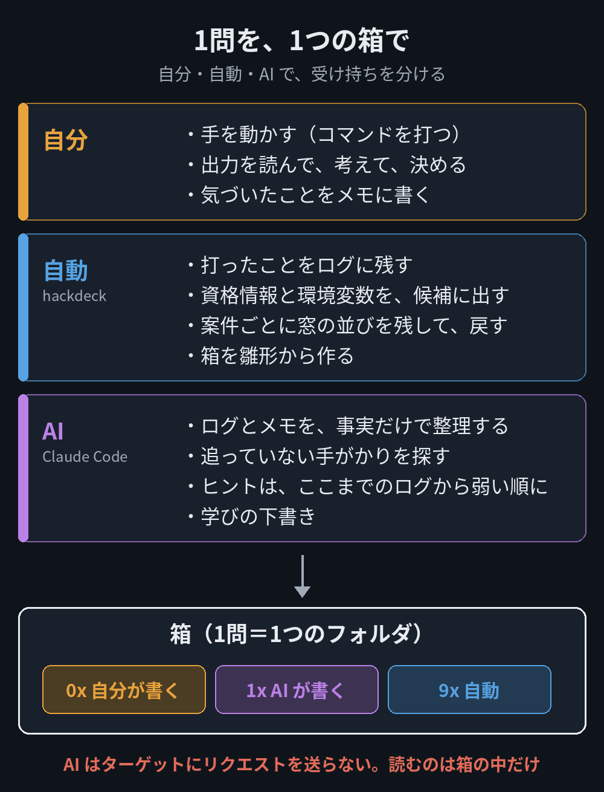
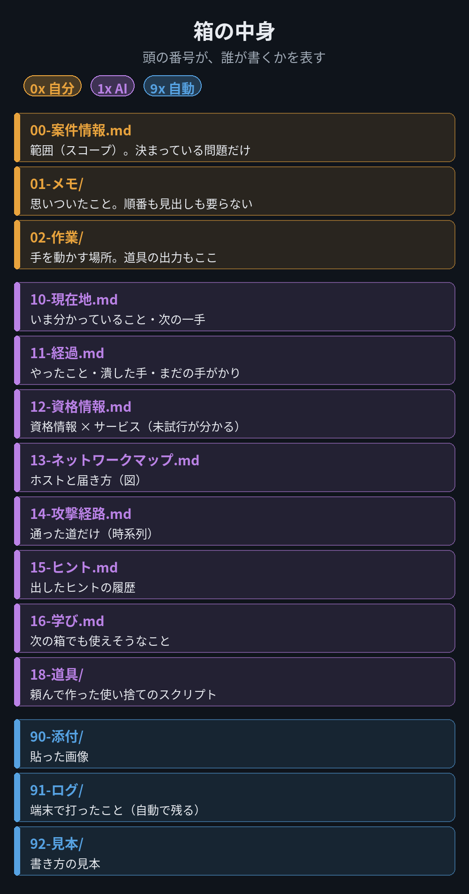
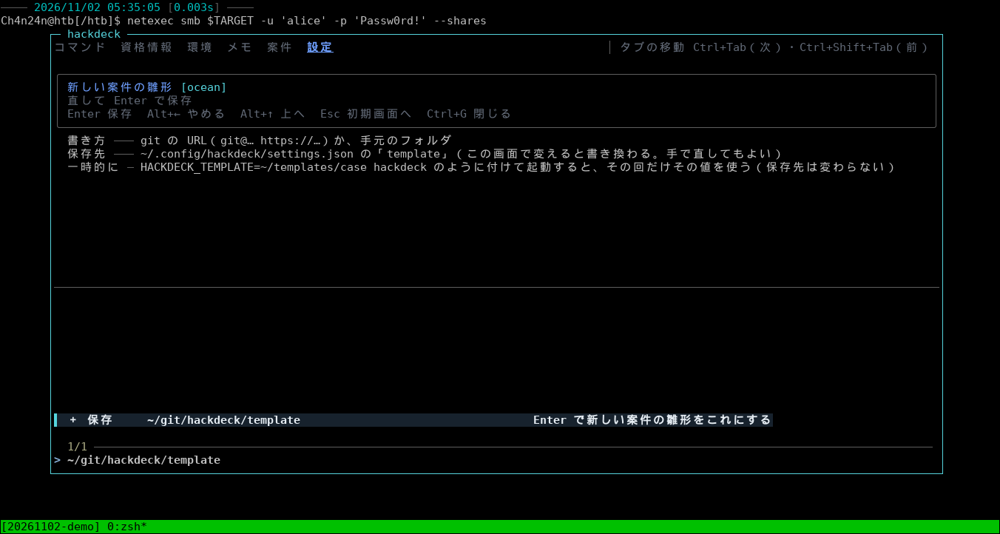

# hackdeck

HTB や CTF の問題を、1問ずつ「箱」（フォルダ）に分けて解くための、端末の道具です。

`Ctrl+G` で窓が開きます。コマンドを選ぶと、その問題で見つけた資格情報や IP が候補に出て、組み立てたコマンドがいまの端末に貼られます。


> [!WARNING]
> **作者が、自分の学習のためだけに作り込んだ道具です。** 画面も説明も日本語だけで、Kali Linux・zsh・tmux・fzf・GNOME Terminal でしか試していません。
> そのまま使うより、「こういう分け方もあるのか」と、考え方を持ち帰ってもらうための公開です。

## 考え方

問題を解くときの仕事を、3つに分けています。



- **自分**: 手を動かして、考えて、決める。ここが学習の本体なので、ほかに任せません
- **自動（hackdeck）**: 打ったことのログ、見つけた資格情報や IP、窓の並び。覚えておくだけの仕事は道具にやらせます
- **AI（Claude Code など）**: ログとメモの整理、見落としの洗い出し、ヒント。AI はターゲットにリクエストを送らず、箱の中のファイルだけを読みます

AI の部分は、このリポジトリには入っていません。箱の中の `CLAUDE.md` に、AI への決まりだけを書いてあります。
詳しい考え方は、作者のブログ（https://ch4n24n.github.io/）に書いています。

## 1問を、1つの箱で

案件のタブで名前を打つと、雛形を写して箱ができます。付属の雛形（`template/`）は、ファイルの頭の番号で、誰が書くかを分けています。



- `0x` は自分が書く（メモ・作業場）
- `1x` は AI が書く（いまの状況・やったこと・資格情報の表・ヒント・学び）
- `9x` は自動（貼った画像・端末のログ）

箱は Obsidian で開いて読む前提です。AI への決まり（事実だけを書く・ヒントは弱い順に・ターゲットに触らない）は、箱の中の `CLAUDE.md` にあります。

## できること

### コマンドを組み立てる

コマンドを選ぶと、中の変数（`<host>` など）を、1つずつ候補から選べます。文字を打つと、どの画面でも一覧が絞れます。

**1. ホストを選ぶ。** 環境変数（`$TARGET`）や `/etc/hosts` の名前が候補に出ます。


**2. 資格情報を選ぶ。** 資格情報のタブに足したものが、道具に合った形（`-u 'alice' -p '…'` など）で出ます。


**3. オプションを選ぶ。**


**4. できたコマンドが、いまの端末に貼られます。** Enter を押すまで走りません。


### 資格情報・環境変数・メモ

**資格情報のタブ**: 見つけたユーザーとパスワード（ハッシュ）を `user:pass:説明` の形で足します。足したものは、コマンドの候補に出ます。


**環境のタブ**: `TARGET`・`DOMAIN` などの環境変数です。変えると、どのペインのシェルにも、次のコマンドから効きます。


**メモのタブ**: 案件ごとの軽いメモを vim で書きます（設定の「メモのタブ」で出します）。


### 案件（箱）を切り替える

案件ごとに、専用の tmux のセッションが開きます。離れても、次に入ると窓の並びと画面が戻ります。端末で打ったことは、案件のログに自動で残ります。


## 入れ方

必要なもの: Linux・tmux 3.3 以上・fzf 0.65 以上・Python 3.8 以上（標準ライブラリだけ）・zsh・flock（util-linux）

```bash
git clone https://github.com/Ch4n24n/hackdeck-public.git ~/git/hackdeck
bash ~/git/hackdeck/install.sh
```

`install.sh` は、要るものの版を確かめて、`~/.local/bin/hackdeck` を置くだけです。`~/.zshrc` と `~/.tmux.conf` は書き換えません（案件のセッションは、専用の tmux で動きます）。

案件の外でも `Ctrl+G` で開きたいときだけ、`~/.zshrc` に1行足します（足さなくても、`hackdeck` と打てば開きます）。

```bash
eval "$(hackdeck shell-init zsh)"
```

## 雛形（箱）

何も設定しなくても、付属の雛形（`template/`）から箱ができます。設定のタブの「新しい案件の雛形」で変えられます（git の URL か、手元のフォルダ。空にすると、作業フォルダとログの置き場所だけを作ります）。



作業フォルダ・データの置き場所・ログの場所の既定も、付属の雛形の形（`02-作業`・`02-作業/.hack`・`91-ログ/実行ログ.log`）です。自分の雛形を使うときは、設定のタブで、その雛形の形に合わせて変えます。

## よく使うキー

| キー | すること |
|---|---|
| `Ctrl+G` | 窓を開く・閉じる |
| `Ctrl+Tab`・`Ctrl+Shift+Tab` | タブを移る |
| `Alt+←`・`Alt+→` | 戻る・進む |
| `Esc` | そのタブの最初の画面へ |
| `Ctrl+R` | コマンドの履歴（コマンドのタブ） |
| `prefix + d` | 案件から離れる（セッションは動いたまま） |

## 自分のコマンド帳を足す

付属のコマンド帳（`cheats/`・`opts/`）は、作者が使っている中身です。自分のコマンドは、`~/.config/hackdeck/cheats/` に `.cheat` のファイルを置けば足せます。

```
% 準備, http
# http.server: いまのフォルダを配る
python3 -m http.server <port>
```

`<port>` のような変数は、窓の中で候補から選べます。書き方は [docs/DESIGN.md](docs/DESIGN.md) の「コマンド帳」にあります。

## 知っておくこと

- 案件の中か外かは、案件のセッションかどうかだけで決まります（案件のフォルダに `cd` しても、案件の中にはなりません）
- シェルの部分（作業フォルダへ戻る・環境変数・ログ・時刻）は zsh だけです
- 作りと決まりの詳しい話は [docs/DESIGN.md](docs/DESIGN.md) にあります

## ライセンス

MIT（[LICENSE](LICENSE)）
