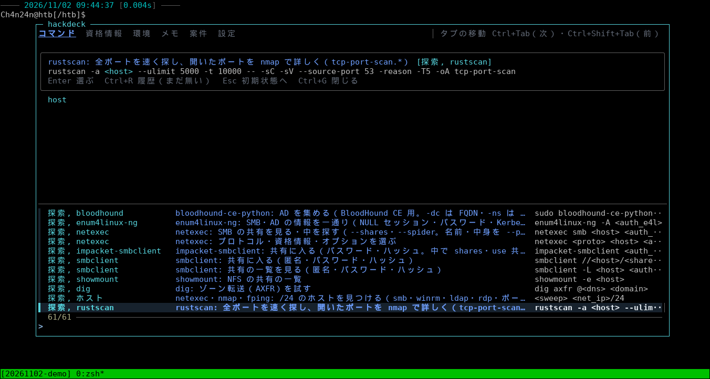
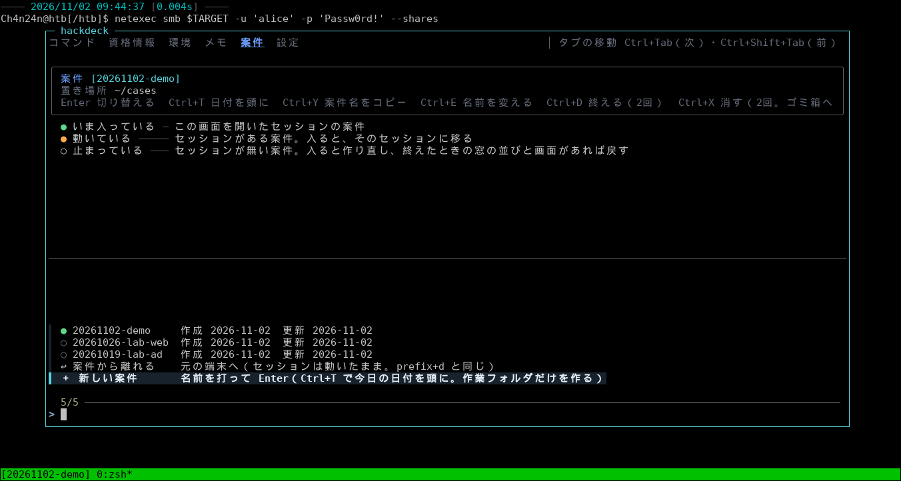
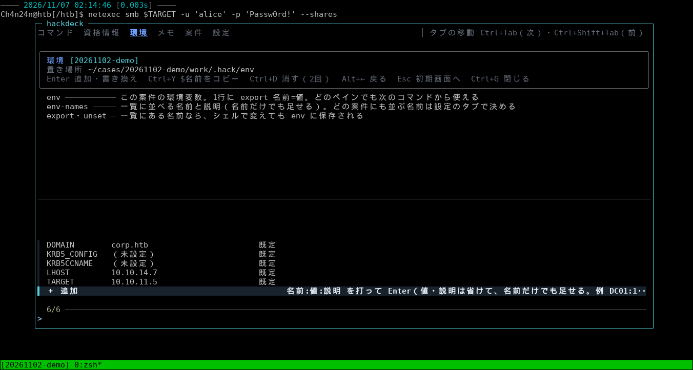
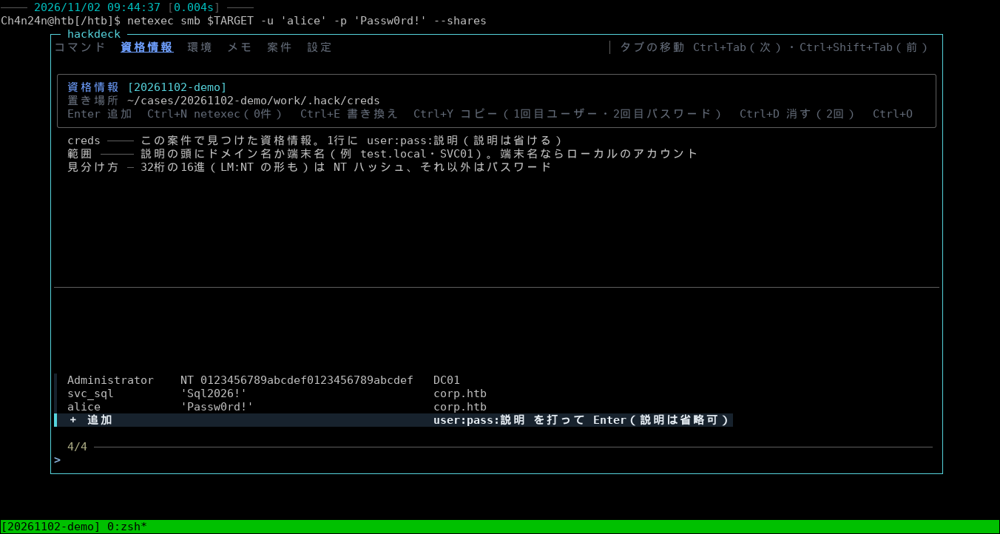
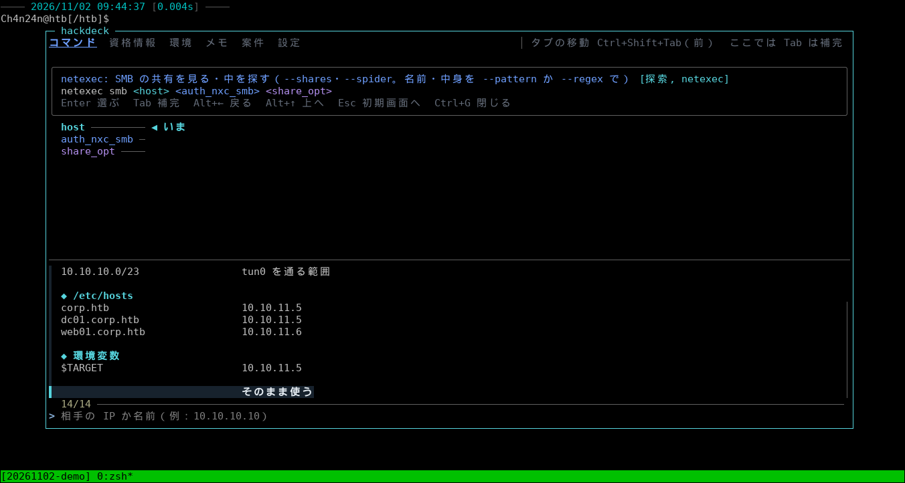
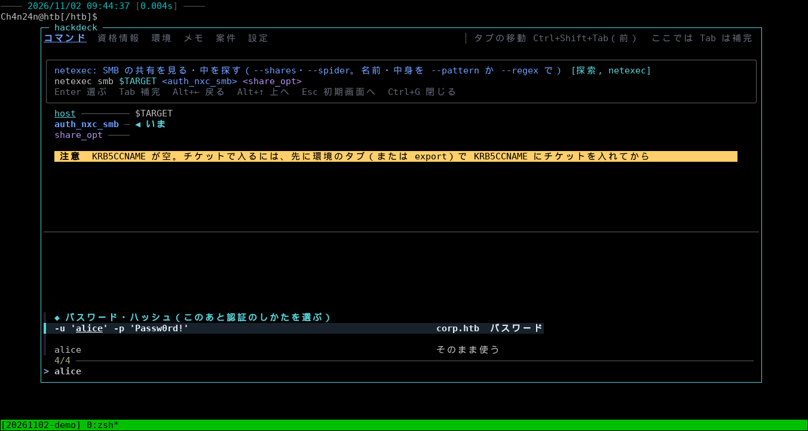
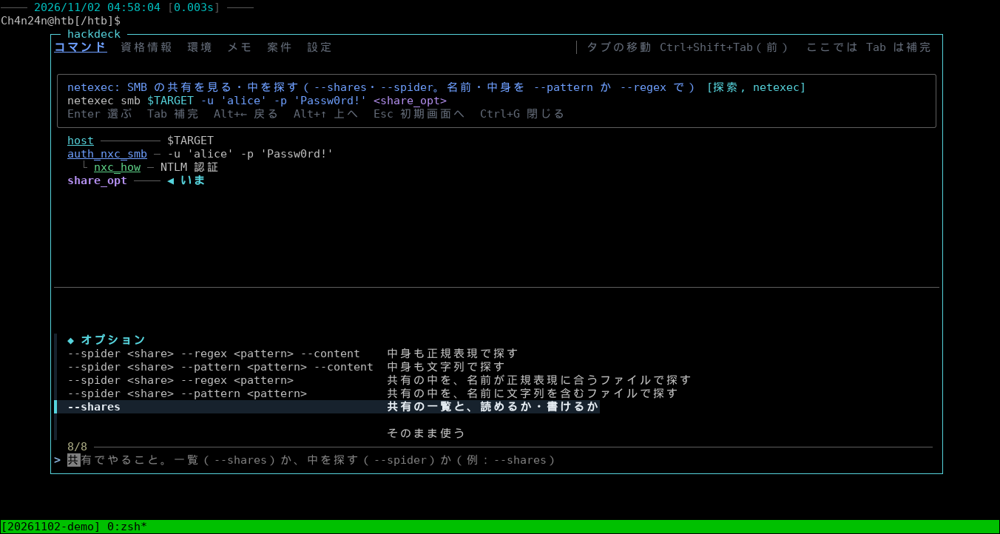
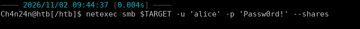
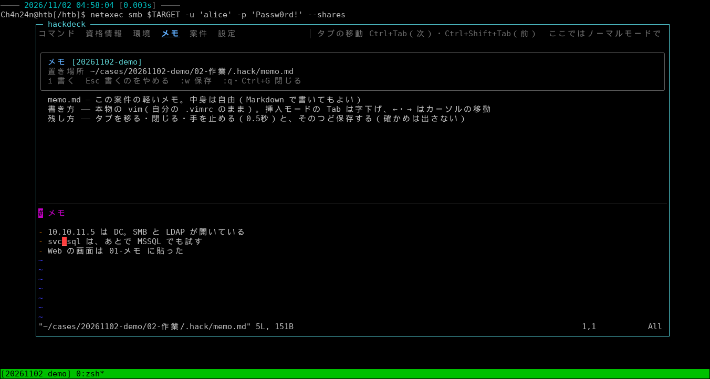

# hackdeck

HTB や CTF の問題を、**tmux のセッション単位で管理する**ツールです。

1つの問題に、1つの tmux セッションと、1つのディレクトリを用意します。ディレクトリは雛形（テンプレート）を clone して作り、作業はそのセッションの中で、そのディレクトリを使って行います。

セッションの中で `Ctrl+G` を押すと、hackdeck のメニューが開きます。メニューでは、次のことができます。

- コマンドを組み立てる（登録した環境変数や資格情報を、候補から選んで埋める）
- 環境変数を登録する（そのセッションの、すべてのウィンドウ・ペインで使える）
- 資格情報を登録する（コマンドを組み立てるときの候補になる）
- メモを書く
- 問題（セッションとディレクトリ）を作る・切り替える・終える



> [!WARNING]
> **作者が、自分の学習のためだけに作り込んだツールです。** 画面も説明も日本語だけで、Kali Linux・zsh・tmux・fzf・GNOME Terminal でしか試していません。
> そのまま使うより、考え方の参考にしてもらうための公開です。

## しくみ

```
hackdeck
 ├─ 問題 A … tmux セッション「A」 ＋ ディレクトリ ~/cases/A（雛形を clone したもの）
 ├─ 問題 B … tmux セッション「B」 ＋ ディレクトリ ~/cases/B
 └─ …
```

- **問題**: 画面では「案件」と呼んでいます。問題ごとに、専用の tmux セッションとディレクトリがあります。セッションから離れても、次に入ると、ウィンドウ・ペインの並びと画面の中身が元に戻ります。
- **環境変数**（`TARGET`・`DOMAIN` など）: 問題ごとに保存されます。そのセッションのすべてのウィンドウ・ペインで使えます。シェルで `export` した値も保存されます。
- **資格情報**（ユーザー名と、パスワードかハッシュ）: 問題ごとに保存されます。コマンドを組み立てるとき、道具に合った書き方（`-u 'alice' -p '…'` など）で候補に出ます。
- **ログ**: セッションで打ったコマンドと、その出力は、問題のディレクトリに自動で残ります。
- hackdeck の tmux は、ふだんの tmux とは別のサーバーで動きます。`~/.zshrc` と `~/.tmux.conf` は書き換えません。

## 使い方

### 1. 問題を作る

`hackdeck` と打つと、メニューが開きます。「案件」のタブで問題の名前を打って Enter を押すと、雛形を clone したディレクトリと tmux セッションができて、そのセッションに入ります。



### 2. 環境変数と資格情報を登録する

「環境」のタブでは、`TARGET` などの環境変数を `名前:値:説明` の形で登録します。登録した値は、そのセッションのすべてのペインで、次に打つコマンドから使えます。



「資格情報」のタブでは、見つけたユーザー名とパスワード（ハッシュ）を `user:pass:説明` の形で登録します。



### 3. コマンドを組み立てる

「コマンド」のタブでコマンドを選ぶと、コマンドの中の変数（`<host>` など）を、1つずつ候補から選べます。文字を打つと、候補を絞れます。

**ホストを選ぶ**: 環境変数（`$TARGET`）や `/etc/hosts` の名前が候補に出ます。



**資格情報を選ぶ**: 登録したものが、道具に合った書き方で出ます。



**オプションを選ぶ**:



**できあがり**: 組み立てたコマンドが、いまのペインの入力行に入ります。Enter を押すまで実行されません。



### 4. メモを書く

「メモ」のタブでは、問題ごとのメモを vim で書けます（「設定」のタブの「メモのタブ」をオンにすると出ます）。



## 雛形（問題のディレクトリの中身）

問題を作るとき、既定では、雛形のリポジトリ [Hacking-Op-public](https://github.com/Ch4n24n/Hacking-Op-public) を clone します。メモ・作業用のディレクトリ・端末のログの置き場所が決まっていて、AI（Claude Code など）が書くノートの置き場所も分けてある雛形です。中身と考え方は、そちらの README にあります。

雛形は「設定」のタブの「新しい案件の雛形」で変えられます。git の URL か、手元のディレクトリを指定します（空にすると、作業用のディレクトリとログだけを作ります）。作業用のディレクトリとログの場所も「設定」のタブで変えられます（既定は、雛形に合わせて `02-作業` と `91-ログ/実行ログ.log`）。

## インストール

必要なもの: Linux・tmux 3.3 以上・fzf 0.65 以上・Python 3.8 以上（標準ライブラリだけ）・zsh・flock（util-linux）

```bash
git clone https://github.com/Ch4n24n/hackdeck-public.git ~/git/hackdeck
bash ~/git/hackdeck/install.sh
```

`install.sh` は、必要なツールのバージョンを確かめて、`~/.local/bin/hackdeck` を置くだけです。

問題のセッションの外でも `Ctrl+G` でメニューを開きたいときだけ、`~/.zshrc` に次の1行を足します（足さなくても、`hackdeck` と打てば開きます）。

```bash
eval "$(hackdeck shell-init zsh)"
```

## よく使うキー

| キー | すること |
|---|---|
| `Ctrl+G` | メニューを開く・閉じる |
| `Ctrl+Tab`・`Ctrl+Shift+Tab` | タブを移る |
| `Alt+←`・`Alt+→` | 戻る・進む |
| `Esc` | そのタブの最初の画面へ |
| `Ctrl+R` | コマンドの履歴（コマンドのタブ） |
| `prefix + d` | 問題のセッションから離れる（セッションは動いたまま） |

## 自分のコマンドを足す

付属のコマンド集（`cheats/`・`opts/`）は、作者が使っている中身です。自分のコマンドは、`~/.config/hackdeck/cheats/` に `.cheat` のファイルを置くと足せます。

```
% 準備, http
# http.server: いまのディレクトリを配る
python3 -m http.server <port>
```

`<port>` のような変数は、メニューの中で候補から選べます。書き方は [docs/DESIGN.md](docs/DESIGN.md) の「コマンド帳」の節にあります。

## 注意

- 問題の中か外かは、問題のセッションの中かどうかだけで決まります（問題のディレクトリに `cd` しても、問題の中にはなりません）。
- シェルの部分（作業用のディレクトリへ戻る・環境変数・ログ・時刻）は zsh だけです。
- 作りの詳しい説明は [docs/DESIGN.md](docs/DESIGN.md) にあります。

## ライセンス

MIT（[LICENSE](LICENSE)）
