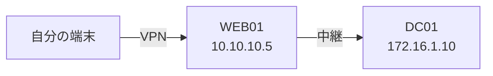

> [!abstract] このノートは書き方の見本。問題とは関係ない
> コールアウトの種類と意味は、ここが一次。

## コールアウト

> [!tip] tip — 自分が書く面
> `00-案件情報.md` `01-メモ/`（中の各メモ） `02-作業/` に付ける。

> [!abstract] abstract — Claude が書く面
> `10` 〜 `16` に付ける。

> [!example] example — 書く形の決まり
> 「1つにつきこの5つを書く」のような、埋める形の提示。

> [!warning] warning — 欠けているもの
> 「画像なし（端末の出力で代わりにする）」など。

> [!danger] danger — 危ないもの
> 範囲の外、壊す操作、取り返しのつかないもの。

> [!success] success — 通った
> 足がかり・権限・資格情報が通った。

> [!quote] quote — 引用
> ログや外の文章をそのまま引くとき。

## 表

| ホスト | IP | OS | 届き方 | 段階 |
| --- | --- | --- | --- | --- |
| WEB01 | 10.10.10.5 | Linux | 直接 | 足がかり |
| DC01 | 172.16.1.10 | Windows Server | WEB01 経由 | 調べ中 |

## 図

